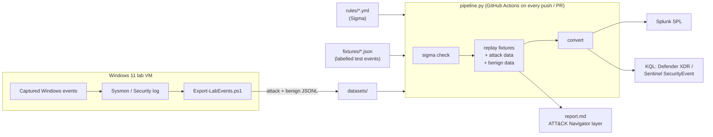

# Detection-as-code pipeline

Windows detections written as Sigma rules, tested in CI, and converted automatically to
Splunk SPL and Microsoft KQL. The rules target the techniques behind most 2025–2026
intrusions: ClickFix social engineering, living-off-the-land binaries, credential dumping,
persistence, Defender tampering, Kerberoasting and the shadow-copy deletion that comes right
before ransomware.

Built and run on macOS; the Windows telemetry comes from a Windows 11 lab VM.

## How it works



A push fails CI if a rule doesn't lint, a labelled test event behaves differently than
expected, a captured attack goes undetected, or (with `--max-fp`) a rule fires too often on
normal activity.

## Rules

| Rule | ATT&CK | Level | What it catches |
| --- | --- | --- | --- |
| `clickfix_powershell` | T1059.001, T1204.004 | medium | Explorer starting PowerShell with hidden, encoded or download-and-run arguments |
| `clickfix_runmru` | T1204.004 | high | A script launcher or URL typed into the Run dialog (RunMRU registry key) |
| `mshta_remote_script` | T1218.005 | high | mshta running a remote HTA or inline javascript:/vbscript: |
| `rundll32_script_execution` | T1218.011 | high | rundll32 running JavaScript via mshtml or loading from a URL |
| `certutil_url_cache` | T1105 | medium | certutil used to download files (-urlcache, -verifyctl; dash or slash) |
| `suspected_lsass_dump` | T1003.001 | high | ProcDump dumping LSASS by name or PID, including renamed copies |
| `comsvcs_minidump` | T1003.001 | high | rundll32 comsvcs.dll MiniDump (by name or ordinal #24) |
| `schtasks_suspicious_create` | T1053.005 | medium | Scheduled tasks running from AppData/Temp/Public or launching script hosts |
| `local_admin_group_add` | T1098.007 | medium | `net localgroup administrators <user> /add` |
| `defender_tamper_powershell` | T1562.001 | high | Set/Add-MpPreference disabling protection or adding exclusions |
| `kerberoasting_rc4_ticket` | T1558.003 | medium | RC4 service tickets for user accounts (event 4769) |
| `inhibit_system_recovery` | T1490 | high | vssadmin, wmic, wbadmin, bcdedit and PowerShell deleting shadow copies or backups |

Each rule notes its known false positives. Renamed binaries are caught through Sysmon's
`OriginalFileName` where it applies, and command-line flags match both `-` and `/` forms.

## Results

The latest numbers are in `build/report.md` after a run, and in the job summary of each
GitHub Actions run.

| Evidence | Status |
| --- | --- |
| Labelled synthetic events (67 cases, positive and tricky negative) | passing in CI |
| Recorded Windows security telemetry (`datasets/attack/`) | to be collected, see [docs/VALIDATION.md](docs/VALIDATION.md) |
| False positives on a day of normal activity (`datasets/benign/`) | to be collected |
| Queries firing inside a SIEM (screenshots in `docs/screenshots/`) | to be collected |

## Run it on macOS

```sh
python3.13 -m venv .venv
.venv/bin/python -m pip install -r requirements.txt
.venv/bin/python -m unittest discover -s tests -t .
.venv/bin/python pipeline.py              # add --max-fp 0 to fail on any false positive
```

Outputs in `build/`:
- `queries/<rule>.spl` - Splunk (Sysmon field names; scope to your Windows index)
- `queries/<rule>.xdr.kql` - Defender XDR advanced hunting (`DeviceProcessEvents`, `DeviceRegistryEvents`)
- `queries/<rule>.sentinel.kql` - Microsoft Sentinel `SecurityEvent` (Security-log rules)
- `attack-layer.json` - open in [ATT&CK Navigator](https://mitre-attack.github.io/attack-navigator/);
  score 1 = passes synthetic tests, score 2 = also detected real captured attack telemetry
- `report.md` / `report.json` - per-rule results

## Repository layout

```
rules/        Sigma rules
fixtures/     labelled test events, one file per rule (positive and negative cases)
datasets/     attack/<technique>.jsonl and benign/*.jsonl exported from the lab VM
pipelines/    custom pySigma pipeline (Sentinel SecurityEvent table)
tools/        Sysmon configuration and Windows event export
tests/        unit tests for the rule evaluator
sigma_match.py  evaluates Sigma rules against JSON events (the subset these rules use)
pipeline.py     lint -> test -> convert -> report
```

## Adding a rule

1. Write `rules/<name>.yml` with an `attack.tXXXX` tag.
2. Add `fixtures/<name>.json` with at least one event that should alert and one that shouldn't.
3. Add a sanitized capture for the technique if you have one.
4. Run `pipeline.py`; open a pull request and let CI check it.

`sigma_match.py` supports the Sigma features these rules use (map and list selections;
`contains`, `startswith`, `endswith`, `all`, `windash`; `and`/`or`/`not`, `1 of`, `all of`)
and fails loudly on anything else, so a rule can't pass by being silently skipped.
